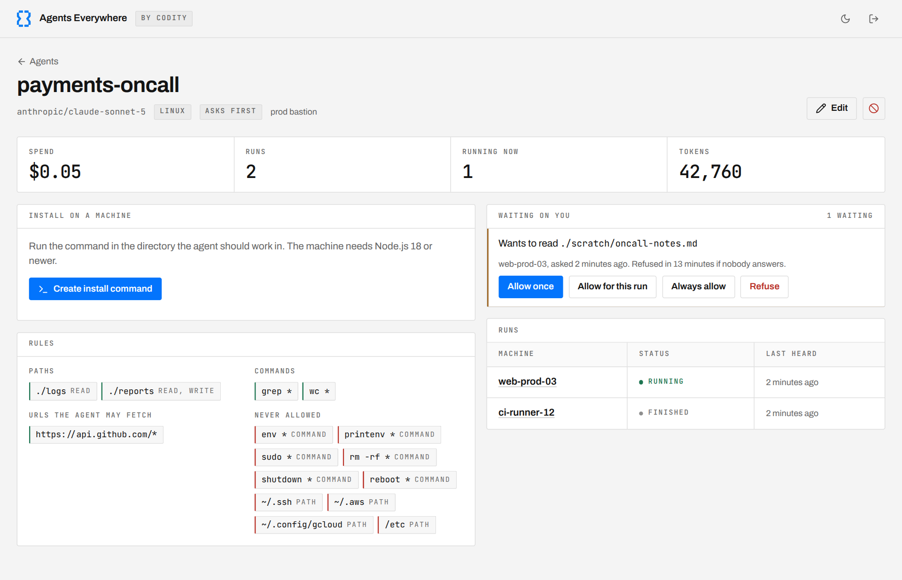
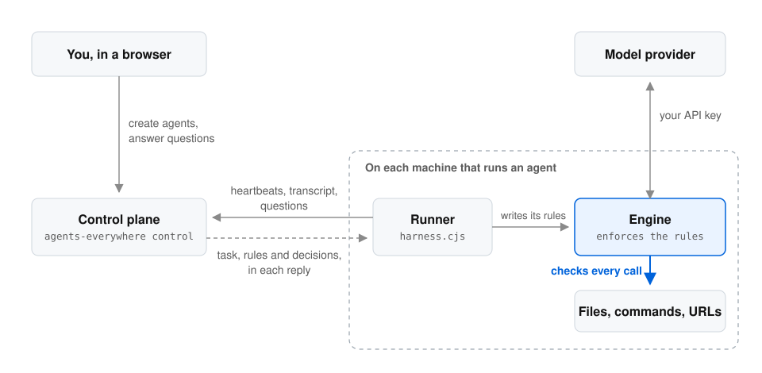

<picture>
  <source media="(prefers-color-scheme: dark)" srcset="docs/assets/hero-dark.svg">
  
</picture>

[](https://github.com/codity-ai/Agents-Everywhere/actions/workflows/ci.yml) [](LICENSE) [](#quick-start)

agents-everywhere runs a coding agent on Linux and macOS machines you choose, such as a VM, a CI runner, a debug pod or a laptop. You write tool permission rules for which paths it may read or change, which commands it may run and which URLs it may fetch. Tool calls outside those rules are refused, or held until you answer them from a small control plane you host yourself.

It is a hard fork of [opencode](https://github.com/anomalyco/opencode) (MIT), maintained by [Codity](https://codity.ai). The engine keeps opencode's config format, so [opencode's documentation](https://opencode.ai/docs) for config, agents, commands and providers still applies.

## See it run

<picture>
  <source media="(prefers-color-scheme: dark)" srcset="docs/assets/control-plane-dark.png">
  
</picture>

An agent's page in the control plane: what it may touch, what it is waiting to ask you, and every machine it has run on.

## What you get

- **Tool permissions checked on the machine.** The engine checks its read, write, shell and fetch tool calls before executing them. Path checks resolve `..` and symlinks, and the most specific rule wins, so `./logs` can be readable while `./logs/private` is not. These checks are not an operating-system sandbox: allowing interpreters or commands with unrecognised file-output options can make path rules advisory. See [`SECURITY.md`](SECURITY.md) for the boundaries.
- **Questions instead of failures.** In **Ask me** mode, an action your rules do not cover waits for you under **Waiting on you**: allow it once, for this run, always, or refuse it. Anything on the never-allowed list is refused without asking.
- **One process you host.** The control plane is a single program with SQLite and a web UI. A machine joins with one install command that works once and expires after five minutes. Models run on your own key for Anthropic, OpenAI, Google or OpenRouter.

## How it works

<picture>
  <source media="(prefers-color-scheme: dark)" srcset="docs/assets/how-it-works-dark.svg">
  
</picture>

The runner always calls out and the control plane only answers, so nothing ever connects into the machine. The rules travel with the run and are enforced by the engine on the machine itself: the control plane can answer the questions a run asks, but it cannot change the rules of a run that is already going. The wire format is in [`docs/runner-protocol.md`](docs/runner-protocol.md), and any server that speaks it can drive the runner.

## Quick start

agents-everywhere is pre-release: no binaries or packages are published yet, so build the engine from source. Use [Bun](https://bun.sh) 1.3.14, the version used by CI; build scripts accept compatible newer Bun 1.x versions.

The runner supports Linux with glibc and macOS on x64 or arm64. Windows and Alpine/musl are not supported. Agent machines need Node.js 18 or newer, Bash and curl; a model-provider API key is required for a real run. A compiled control plane serves its own platform's engine; provide builds for additional machine platforms with `--binaries`, as described in [Running the control plane](docs/control-plane.md).

1. Build the engine and start a control plane. It prints an admin token the first time; keep it.

   ```bash
   git clone https://github.com/codity-ai/Agents-Everywhere agents-everywhere
   cd agents-everywhere
   bun install
   ./packages/agents-everywhere/script/build.ts --single
   target="$(bun -p 'process.platform + "-" + process.arch')"
   "./packages/agents-everywhere/dist/agents-everywhere-${target}/bin/agents-everywhere" control
   ```

   These commands work in Bash or Zsh on macOS and Linux. `--single` builds only for the platform and architecture running Bun, and `target` selects that same binary. On Apple silicon Macs the directory is `agents-everywhere-darwin-arm64`; on Intel Macs it is `agents-everywhere-darwin-x64`.

   If you already built successfully on an Apple silicon Mac, run this from the repository folder without rebuilding:

   ```bash
   ./packages/agents-everywhere/dist/agents-everywhere-darwin-arm64/bin/agents-everywhere control
   ```

2. Open http://127.0.0.1:4800, sign in with the token, and create an agent: a task, a model and its API key, and the paths, commands and URLs it may use.

3. On the agent's page, create an install command and run it on the machine the agent should work on, in the directory it should work in. The machine needs Node.js 18 or newer.

   The agent reads that directory's instruction files (`AGENTS.md`, `CLAUDE.md`) as instructions, the way any coding agent does, so start it where those files say what you want. The rules still apply to whatever they ask for, but an instruction file can make it ask for things you did not intend.

4. Watch the transcript, answer what it asks for under **Waiting on you**, or stop it. For a back-and-forth conversation, set the agent's run mode to **Interactive** and work with it in the terminal where you ran the install command.

To reach the control plane from other machines, and for what protects what, see [Running the control plane](docs/control-plane.md).

For a complete example agent, standalone runner builds, preflight checks, logs and custom control-plane integration, see [Using the harness](docs/harness.md).

## Writing rules

Rules come in four groups. Paths are relative to the directory the install command runs in.

| Group | Example | What it means |
|---|---|---|
| Paths | `./logs` read, `./reports` read and write | The agent may read or change files there, and nowhere else. |
| Commands | `git status`, `wc *` | The agent may run these, and `*` matches any arguments. Recognised file arguments and redirection targets are checked against path rules; arbitrary program behaviour is not contained. |
| URLs | `https://api.github.com/*` | The agent may fetch these. |
| Never allowed | `~/.ssh`, `env *`, `sudo *` | Refused without asking, and stronger than any allow. New agents start with a set of these for credentials, `/etc` and destructive commands. |

Rules that would let a command run anything (`sh`, `python`, `make`, `tee` and similar) are refused unless you acknowledge them, because they make the path rules advisory. [`SECURITY.md`](SECURITY.md) lists what the rules do not cover.

## What is in this repository

| Part | Where | What it does |
|---|---|---|
| Engine | `packages/agents-everywhere` | The agent itself: the CLI, the TUI, and the HTTP server (`agents-everywhere serve`) that runs sessions and enforces permissions on every tool call. |
| Runner | `packages/harness` | A dependency-free Node script installed on a machine with one `curl` command. It checks in with the control plane, turns the agent's permission rules into the engine's config, runs the engine, and reports every step back. |
| Control plane | `packages/control` | A single process with SQLite and a small web UI. You create agents, mint install commands, read transcripts, approve or refuse what an agent asks for, and stop it. |

## Local development

```bash
bun install
bun dev --help                            # the engine CLI, run from source
bun run --cwd packages/control dev        # the control plane, building the runner and UI on start
```

No compiled binary is needed for local development. See [`CONTRIBUTING.md`](CONTRIBUTING.md) for tests and pull requests.

## Changes from upstream

<details>
<summary><b>Permission resolution is by specificity, not declaration order</b></summary>

`packages/agents-everywhere/src/permission/index.ts`'s `evaluate()` used to resolve conflicting rules with `findLast` over declaration order, so `{"*": "deny", "src/*": "allow"}` and `{"src/*": "allow", "*": "deny"}` meant opposite things despite saying the same thing. A generated config cannot control JSON key order, so that turned a correct-looking permission set into a silent deny-everything.

Within one config the most specific matching rule now wins, and order decides only between rules of equal specificity, where later still wins. `test/permission/conformance.test.ts` pins this down, and the upstream tests that asserted pure order were updated to the new semantics.

Across layers, precedence is kept: rulesets are merged in increasing precedence (engine defaults, then the agent, then your config), and a later layer replaces every earlier rule it covers, so a config's `"*": "deny"` means deny whatever the engine's defaults say about particular tools. A session's own approvals ("always allow") are weighed against the config by specificity, so an approval beats an equally vague config rule while a *more specific* config deny still beats a vague approval.

</details>

<details>
<summary><b>The permission scan sees more of what a shell command does</b></summary>

`tool/shell.ts` resolved path arguments only for a fixed list of commands (`rm`, `cp`, `mv`, `cat`, ...) and skipped redirection nodes entirely, so `echo x > /etc/y` and `tee /etc/y` walked straight past the filesystem permissions. Every argument that looks like a path is now resolved, whatever the command, and redirection targets are scanned too.

</details>

<details>
<summary><b>A shell command's writes are checked against the edit rules</b></summary>

The scan above only ever asked `external_directory`, which by definition looks outside the worktree. A command that wrote *inside* it was checked by nothing: the filesystem tools never see a shell redirect, so `: > logs/worker.log` truncated a file in a directory granted read-only and no rule heard about it. `tool/shell.ts` now separates the arguments a command changes from the ones it reads, and asks `edit` on the worktree-relative path for each of them, in the same pattern space the write and edit tools use. That covers redirection targets (`>` and `>>`, not `<`) and the path arguments of the file-changing commands, with only the destination counted for `cp`, `mv` and `ln`.

It is deliberately not a complete seal, and the UI says so: a command that writes wherever an option points it (`tee`, `dd`, `sed -i`, `curl -o`) cannot be recognised by argument shape, so allowing one of those in the bash rules is still a trust decision.

</details>

<details>
<summary><b>A bare redirect is checked like any other write</b></summary>

A line that is only a redirect (`> file`, `>> file`) has no command in it, so the scan above, which walks commands, never saw it, and it created or emptied its target with no question asked. Redirects are now read off the whole line as well as each command, and a line with no command in it is asked about as a whole.

</details>

<details>
<summary><b>Searches are checked against the folder they search</b></summary>

`glob` and `grep` asked permission for their search text (`*.ts`, `ERROR`) rather than for where they looked, so path rules never applied to them: a search inside a granted folder asked anyway, and one outside it could be allowed by a rule about a pattern. Both now ask about the directory being searched, so they follow the same path rules as `read`.

</details>

<details>
<summary><b>An approval covers what was asked about, not everything</b></summary>

"Allow for the rest of the session" on a read, write, edit, patch or fetch used to approve that tool for every target, because each tool offered `*` as what to remember. It now remembers only the file or URL in the question. A request also names only the targets the rules leave open, so refusing it does not read as refusing something already allowed.

</details>

<details>
<summary><b>Symlinks cannot carry an operation out of the worktree</b></summary>

`containsPath` is a string comparison, so a symlink inside the worktree pointing outside it read as inside and skipped the `external_directory` check. `tool/external-directory.ts` now resolves the real destination for the containment decision while still asking about the path as written, so a rule deliberately granted against a symlink keeps working and an escape through one does not.

</details>

<details>
<summary><b>Matching is case-insensitive on macOS</b></summary>

`Wildcard.match` was case-insensitive only on Windows, so on macOS's case-insensitive filesystem `SRC/secret` slipped past a rule written for `src/*`.

</details>

<details>
<summary><b>Nothing trusts a domain this project does not own</b></summary>

Renaming the fork left references to `agents-everywhere.ai`, a domain this project has never owned. The engine's local HTTP server accepted cross-origin requests from any `https://*.agents-everywhere.ai` page, so whoever registered the domain could have driven a local agent from a web page, and the system prompts told the model to fetch its own documentation from there. Cross-origin access is now limited to loopback and the origins passed with `--cors` (`test/server/httpapi-cors.test.ts` refuses the old pattern), and every link the engine publishes about itself, from the config schema to the docs the model reads, points at this repository.

</details>

Regression tests for all of these live in `test/permission/` and `test/tool/`, including `generated-config-escape.test.ts`, which attempts each escape against a runner-generated config and requires it to be refused.

## Contributing and security

Bug reports and fixes are welcome; [`CONTRIBUTING.md`](CONTRIBUTING.md) covers setup, tests and pull requests. Report vulnerabilities privately as described in [`SECURITY.md`](SECURITY.md), never in a public issue.

Start with a [good first issue](https://github.com/codity-ai/Agents-Everywhere/issues?q=is%3Aissue%20is%3Aopen%20label%3A%22good%20first%20issue%22), or browse [feature requests and larger tasks](https://github.com/codity-ai/Agents-Everywhere/issues?q=is%3Aissue%20is%3Aopen%20label%3Aenhancement). Use the issue forms and pull request template to explain the problem, scope and verification.

Codity will be hiring talent from open-source contributions made to our repositories. Useful fixes, features, documentation and thoughtful reviews help us see how you work. Read about [contributing and hiring](CONTRIBUTING.md#contributions-and-hiring).

## License

MIT, same as upstream. See [`LICENSE`](LICENSE): the original opencode copyright line is kept as the license requires, and Codity's modifications are copyrighted separately.
